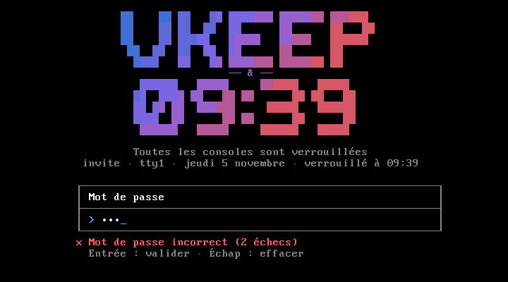

# vKeep

[](https://github.com/Hypotew/vKeep/actions/workflows/ci.yml)
[](LICENSE)

**Le verrou de console Linux qui vous dit qui a essayé d'entrer.**

vKeep protège vos consoles le temps de votre absence. Dans la lignée de `vlock`, il reste simple à
utiliser, avec un écran soigné en plus. Et si quelqu'un tente sa chance, il le note et prend sa photo.



## Fonctionnalités

- **Toutes vos consoles protégées** : avec `-a`, impossible de passer sur une autre console virtuelle.
- **Photo des tentatives** : avec `-a`, chaque mauvais mot de passe et chaque changement de console
  refusé déclenche une photo, sur une webcam détectée automatiquement.
- **Alertes sur votre téléphone** : verrouillage, tentatives (avec la photo) et déverrouillage
  arrivent en direct sur un salon Discord, où que vous soyez.
- **Bilan au retour** : dès le déverrouillage, vous voyez ce qui s'est passé pendant votre absence.
- **Un écran agréable à regarder** : logo en dégradé, grande horloge, et un affichage qui s'adapte à la
  console comme aux terminaux graphiques.
- **Aucun droit particulier** : vKeep tourne avec votre compte et vérifie le mot de passe via PAM,
  le système d'authentification standard de Linux.
- **Un verrou qui ne dépend pas de la caméra** : webcam absente ou en panne, il reste actif et
  se déverrouille normalement.

## Installation

Téléchargez la dernière archive depuis la page
[Releases](https://github.com/Hypotew/vKeep/releases), puis :

```sh
tar xzf vkeep-*-linux-x86_64.tar.gz
cd vkeep-*-linux-x86_64
scripts/install.sh
```

Le script installe `ffmpeg` s'il manque (`--no-camera` pour s'en passer), puis `vkeep` et son fichier
PAM. Il demande votre mot de passe au moment voulu. Pour tout retirer : `scripts/uninstall.sh`, en
ajoutant `--purge` pour supprimer aussi vos photos et votre journal.

L'archive est compilée pour Linux x86_64 récent. Si le binaire ne démarre pas sur votre système, ou
si vous préférez compiler vous-même, installez depuis les sources :

```sh
git clone https://github.com/Hypotew/vKeep.git
vKeep/scripts/install.sh
```

## Utilisation

| Commande | Effet |
|---|---|
| `vkeep` | Verrouille la console courante |
| `vkeep -a` | Verrouille toutes les consoles virtuelles et photographie les tentatives |
| `vkeep -a --camera=/dev/video2` | Pareil, avec la webcam de votre choix |
| `vkeep --test-notify` | Envoie un message de test sur votre salon Discord |

Pour déverrouiller, saisissez le mot de passe de votre compte. `vkeep -a` doit être lancé depuis une
console virtuelle (`Ctrl-Alt-F3`, par exemple), pas depuis un terminal graphique.

## Alertes Discord

vKeep peut vous prévenir sur votre téléphone, via l'application Discord :

1. Créez un serveur Discord privé, avec un salon pour vKeep.
2. Dans les paramètres du salon : **Intégrations** › **Webhooks** › **Nouveau webhook**, puis
   **Copier l'URL du webhook**.
3. Enregistrez-la, lisible par vous seul :

   ```sh
   mkdir -p ~/.config/vkeep
   echo 'discord_webhook = https://discord.com/api/webhooks/…' > ~/.config/vkeep/config
   chmod 600 ~/.config/vkeep/config
   vkeep --test-notify
   ```

4. Pour être notifié de chaque message, réglez les notifications du salon sur **Tous les messages**.

Vous recevez alors un message au verrouillage, un à chaque tentative (avec sa photo quand `-a` en
prend une), et un au déverrouillage avec le bilan. Les envois se font en arrière-plan : sans réseau,
le verrou fonctionne exactement pareil, et les erreurs sont notées dans `notify-errors.log`.

L'URL du webhook permet à quiconque la connaît d'écrire dans votre salon : gardez-la pour vous. Si elle
fuit, supprimez le webhook dans Discord et créez-en un autre.

## Vos données

Les photos et le journal `attempts.log` restent sur votre machine, dans `~/.local/state/vkeep/`, un
dossier accessible à vous seul. vKeep ne les supprime jamais : à vous de faire le tri.

Sans alertes Discord, rien ne quitte votre machine. Avec, les messages et les photos des tentatives
sont aussi envoyés à Discord, et conservés sur ses serveurs comme tout message du salon.

Photographier une personne à son insu peut être illégal. Prévenez les personnes concernées, et
renseignez-vous sur les règles en vigueur avant d'utiliser `-a` ailleurs que chez vous.

## Ce que vKeep ne protège pas

Comme tout verrou logiciel, vKeep a ses limites :

- **La session graphique** : vKeep protège les consoles. Dans un terminal graphique, seule cette
  fenêtre est verrouillée, et le reste de votre bureau reste accessible.
- **L'accès physique** : quelqu'un devant la machine peut toujours l'éteindre ou la redémarrer.
  Ça n'ouvre pas votre session, mais le travail non enregistré est perdu, sans photo ni trace.
- **Les raccourcis du noyau** : selon votre configuration, `Ctrl-Alt-Suppr` peut redémarrer la machine,
  et `SysRq` peut arrêter vKeep. Pour un verrou plus solide, gardez `SysRq` limité (`kernel.sysrq=16`)
  et désactivez le raccourci avec `sudo systemctl mask ctrl-alt-del.target`.
- **Votre propre compte** : un programme lancé sous votre compte, par exemple via SSH, peut arrêter vKeep.

## Développement

```sh
make test       # tests dans un pseudo-terminal
make coverage   # les mêmes, avec échec sous 80 % de lignes couvertes (nécessite uv)
make vm-test    # vraies consoles dans une VM QEMU
```

## Licence

Distribué sous licence [MIT](LICENSE).
